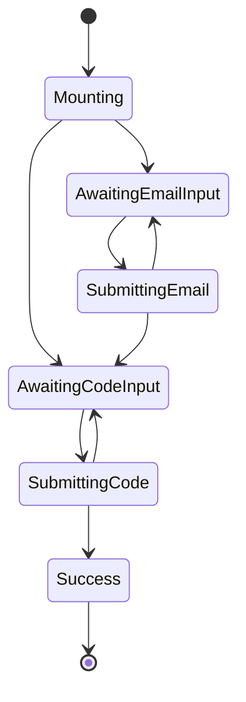

import { Blockquote } from '@components/Blockquote'

<Blockquote
  cite={{
    url: 'https://massimilianomirra.com/notes/expressive-components-in-vanilla-react-part-1-type-states',
    title: 'Expressive components in vanilla React, part 1: TypeStates',
  }}
>
  이건 그냥 상태 머신 아닌가? 그렇다! … "불리언 수프"에 기대는 컴포넌트도
  마찬가지다. 선택은 상태 머신을 만드느냐 마느냐가 아니라, 암시적으로
  만드느냐 명시적으로 만드느냐다.
</Blockquote>

